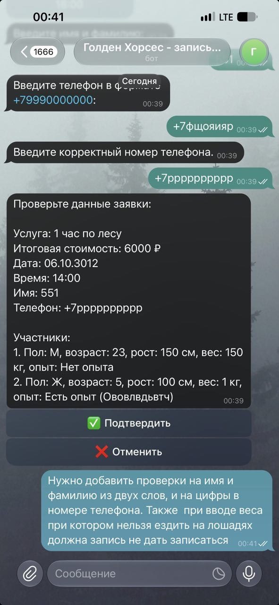

University: [ITMO University](https://itmo.ru/ru/)
Faculty: [FICT](https://fict.itmo.ru)
Course: [Vibe Coding: AI-боты для бизнеса](https://github.com/itmo-ict-faculty/vibe-coding-for-business)
Year: 2025/2026
Group: U4225
Author: Попинова Екатерина Дмитриевна
Lab: Lab3
Date of create: 12.10.2026
Date of finished: 12.10.2026

---

# Лабораторная работа №3
## "Запуск бота для реального использования"

---

## 1. Описание деплоя

### Способ деплоя

**Railway** — облачная платформа для хостинга приложений.

### Почему именно этот

1. **Работает 24/7** — не нужен мой компьютер.
2. **Бесплатный тариф** — 500 часов/мес.
3. **Простая настройка** через GitHub.
4. **Автодеплой** при пуше.
5. **Логи** в реальном времени.

### URL бота

**Бот в Telegram:** https://t.me/itmoftmi_ped_bot

---

## 2. Процесс деплоя

### Пошаговая инструкция

1. Создала репозиторий `golden-horses-bot` на GitHub.
2. Загрузила код (без `.env`).
3. Создала `Procfile` с командой `worker: python bot.py`.
4. Зарегистрировалась на Railway через GitHub.
5. Создала проект из репозитория.
6. Добавила переменную `BOT_TOKEN` в Variables сервиса.
7. Railway автоматически задеплоил.
8. Проверила логи — бот запущен.
9. Проверила в Telegram — бот отвечает.

### С какими проблемами столкнулась

| Проблема | Решение |
|----------|---------|
| Railway не видел `BOT_TOKEN` | Добавила переменную в сервис, а не в проект |
| Конфликт между локальным и облачным ботом | Остановила локального, когда работает облачный |
| Ошибка `Conflict` в Telegram | Только один экземпляр бота с одним токеном |
| Ошибка `asyncio` (Python 3.14) | Использовала `asyncio.run(run_bot())` |
| В Git попали лишние файлы | Удалила `Accept:`, `GET`, `Host:` |

---

## 3. Сбор фидбека

### Количество пользователей

**3 человека** 

### Скриншоты отзывов

## 3. Анализ фидбека

### Главные проблемы

1. **Создание записи для запрещенной весовой категории** 
2. **Нужно вписывать имя и фамилию** 
3. **Неудобный ввод номера телефона** 

### Что понравилось

- 🐴 Красивое меню с эмодзи
- ⚡ Быстрая запись
- 💰 Актуальные цены
- 📝 Памятка посетителя
- 📱 Кнопка отправки контакта

## 4. Выводы

### Что получилось хорошо

- Бот работает **24/7** в облаке.
- Собран **реальный фидбек** от пользователей.
- Внесены **улучшения** на основе отзывов.
- Бот **стабильно работает**.
- Деплой на **Railway** — простой и бесплатный.

### Что можно улучшить

- Добавить **панель администратора**.
- Интегрировать **оплату**.
- Добавить **статистику использования**.

### Чему научились

- Деплой на **Railway**.
- Работа с **переменными окружения**.
- Итеративное улучшение продукта.
- Разрешение конфликтов между локальным и облачным ботом.

### Как это помогло

1. **Добавили валидацию имени** — только буквы, без цифр.
2. **Заменили ввод телефона** на кнопку «📱 Отправить номер».
3. **Добавили проверку веса:**

